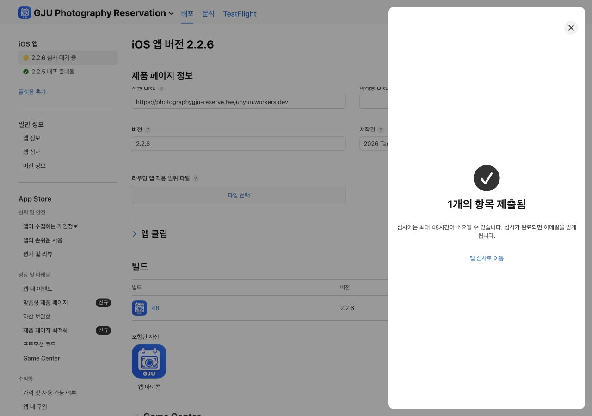

# iOS 2.2.6 (48) 디지털사진영상실 업데이트

사용자 요청에 따라 디지털실 좌석 예약과 최종 메인화면 수정을 iOS 앱에 반영한다. 웹은 이미 배포된 `c9632c14d127e24c60d3238004ada1269ad2561d`를 유지한다.

## 후보 빌드

- App Store ID: `6784429269`, bundle: `kr.ac.gju.photomedia.reserve`.
- 공개 버전 2.2.5 (47)를 App Store Connect와 Apple 공개 조회 API에서 확인했다.
- 후보: **2.2.6 (48)**. 소스 커밋 `d4dc8c6c846c631e83178e0684eeb2bb414d5acb`.
- `npm run build:native`, `cap sync ios` 완료. Android 자산은 동기화하지 않았다.
- Xcode 27.2, iphoneos27.2 SDK. iPhone portrait, iOS 15 minimum 유지.
- 아카이브: `build/ios-20261111-2.2.6-48/AppStoreCheck.xcarchive`.
- 아카이브 성공 및 `codesign --verify --deep --strict` 종료 0. 번들 ID, 버전/빌드, native manifest 소스 커밋과 43개 파일 SHA-256 일치.

## 검사 결과

- `npm run release:check` **종료 0**. 구문/타입, 도메인/API/권한/보안, 저장소, 알림, 공간 현황, 디지털실 예약, 사전 출시 및 네이티브 준비 검사를 통과했다.
- 전체 UI: **206 passed, 53 skipped, 0 failed**. 프로젝트별 조건에 따른 skip이며 실행 실패를 숨긴 것이 아니다.
- 첫 실행에서 5개 공간을 기대하던 모바일 검사를 현재 6개 공간으로 수정하고 디지털실 표시도 명시적으로 확인했다.
- 첫 실행 후반에 공유 임시 DB 경로가 사라지는 ENOENT가 발생했다. 삭제 원인은 확정하지 않았으며, 최종 실행은 `GJU_E2E_DATA_DIR=$(mktemp -d /tmp/gju-ios-release-data.XXXXXX)`로 격리하여 모두 통과했다.
- 복도 두 방의 위치를 서로 다른 시점에 측정해 진입 애니메이션 중 y좌표가 달라지는 검사를 수정했다. 동일 프레임에서 두 벽을 함께 측정하고 기존 인접/동일 높이 검증은 유지했다.
- 위 두 변경은 검사 코드에만 해당하며 아카이브에 포함된 앱 소스는 바뀌지 않았다.
- iPhone 17 Pro / iOS 26.5 Simulator 빌드, 설치, 실행 성공. PID 77955가 계속 실행 중임을 확인했다. Device Hub의 컴퓨터 제어 화면 캡처가 실패하여 시뮬레이터 시각 검사는 완료하지 못했다. 실기기 검사는 하지 않았다.
- [검증 요약 JSON](assets/2026-11-11-ios-2.2.6/validation.json).

## App Store Connect

- 기존 심사 로그인/연락처를 유지하고 2.2.6 버전 초안을 생성했다.
- 제품 설명, 업데이트 사항, 디지털실 심사 경로를 저장했다.
- 승인 후 자동 출시 및 모든 사용자에게 즉시 업데이트 출시가 선택되어 있다.
- 2026-11-11 **13:25:14 KST** Xcode App Store Connect 업로드 성공 및 export 종료 0. [업로드 영수증](assets/2026-11-11-ios-2.2.6/upload-receipt.txt).
- 빌드 처리 완료 후 `2.2.6 (48)`을 버전에 연결했다. 빌드 ID: `f955451a-db9e-4795-ade7-c38588696adc`.
- 네이티브/프런트엔드 코드와 종속성을 확인하고 별도 구현 암호화 알고리즘 없음(OS HTTPS 사용)으로 수출 규정 질문에 답했다.
- **2026-11-11 13:31 KST 심사 제출 완료 확인**, App Store Connect의 `1개의 항목 제출됨`, **`2.2.6 심사 대기 중`**을 확인했다.
- 심사 제출 ID: `f002a612-4a43-41db-b7c5-de47227cf5fa`. [심사 상세](https://appstoreconnect.apple.com/apps/6784429269/distribution/reviewsubmissions/details/f002a612-4a43-41db-b7c5-de47227cf5fa).
- 제출 후에도 승인 후 자동 출시와 전체 사용자 즉시 출시 옵션이 선택된 것을 확인했다. 기존 평가는 유지했다.
- **Apple 승인 및 2.2.6 공개 출시는 아직 확인되지 않았다.** 수동 출시를 기다리는 설정이 아니며 승인 시 자동 공개된다.

운영 시험 예약이나 계정 변경, GitHub push는 수행하지 않았다. Apple 심사 제출과 실제 공개 출시는 별도로 확인한다.
